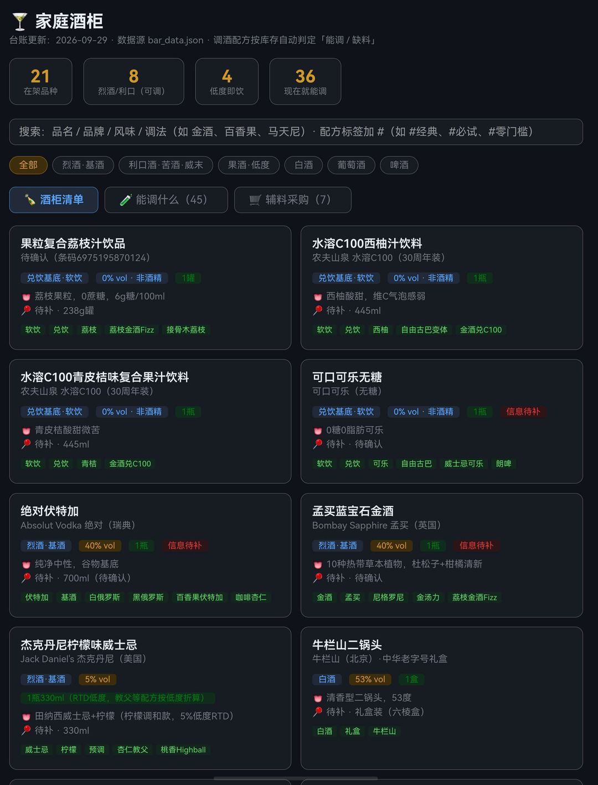
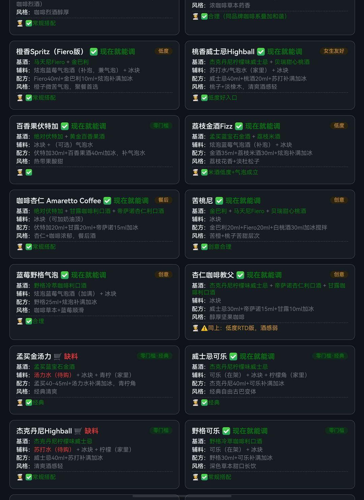

# 🍸 Home Bar Ledger · 家庭酒柜台账

> 每个酒柜 app 都死于「要把库存保持正确」这个执念。我们不跟你较劲——
> 台账就是一个 JSON 文件，你的 AI agent 替你维护，页面只负责好看。

**30 秒能跑起来 · 零依赖 · 数据不出家门 · AI-agent-ready**

English TL;DR: a self-hosted home-bar inventory + cocktail matcher in one static page and one JSON file. No database, no build chain, no cloud. Ships with an optional MCP server so your AI agent (Claude Code / any MCP client) can read and update your bar directly.

| 酒柜清单 | 能调什么 |
|:---:|:---:|
|  |  |

---

## 它回答的唯一问题

> 「今晚朋友来，我柜里这些东西，现在能调出什么？」

页面按你的库存自动把配方分成 ✅能调 / 🛒缺料 / 🍾缺基酒，缺什么直接生成辅料采购清单。

## Quickstart

```bash
git clone https://github.com/yfkja/home-bar-ledger && cd home-bar-ledger
mkdir -p data && cp data.example.json data/bar_data.json   # 或直接让你的 agent 建库，见下
python3 serve.py                    # → http://127.0.0.1:8788（默认只绑本机）
python3 serve.py --lan              # 需要手机在局域网打开时显式加 --lan
```

就这些。Python 3.8+ 标准库，没有 pip install，没有 node_modules，没有 Docker。
工具无鉴权，`--lan` 的信任边界是「你可信整个局域网」——公共 WiFi 下不要开。

### 让 AI agent 帮你维护台账（推荐姿势）

把 `AGENTS.md` 甩给你的 agent（Claude Code / 任何能读写文件的助手），说：

> "这瓶是新来的，入册，顺便看看能解锁什么新喝法"

它会照契约改 `data/bar_data.json`，页面刷新即生效。库存更新的成本从「打开 app → 填 8 个字段」降为「把瓶子递给摄像头」。

### MCP 模式（进阶，可选）

`mcp/barkeeper.py` 是一个 ≤120 行的零依赖 MCP server（stdio）：

```json
{"mcpServers": {"home-bar": {"command": "python3", "args": ["mcp/barkeeper.py"]}}}
```

5 个工具、约 500 token schema——刻意做小，让本地小模型也用得起。设计上**不替 agent 做匹配判断**：`list_inventory` + `list_recipes` 给原料，"能调什么"由你的 agent 交叉比对（它的模糊匹配比任何写死的规则都聪明，比如它知道配方里的"金酒"对应你瓶子上写的"Bombay Sapphire"）。

## 文件职责（small enough to read，全部 <600 行）

| 文件 | 行数 | 职责 |
|:---|--:|:---|
| `serve.py` | ~90 | HTTP + **启动时数据契约校验**（不合法拒绝服务，而不是页面白屏） |
| `static/index.html` | ~200 | 全部 UI，原生 JS 单文件，无框架 |
| `data/bar_data.json` | — | 你的库存 = 唯一事实源，人可读、git 可管、agent 可写 |
| `mcp/barkeeper.py` | ~120 | 可选 MCP server |
| `AGENTS.md` | ~60 | 给你的 agent 的维护手册（字段契约 + 校验规则） |

## 数据契约（摘要）

```jsonc
{
  "items":   [{ "name","brand","type","cat","abv","size","qty","stock","flavor","tags","note","exp" }],
  "recipes": [{ "name","spirits":["柜内品名"],"need":["辅料（在架|待购）"],"ratio","style","verdict","level" }],
  "mixers":  [{ "name","need","stock","pairing" }],
  "base_drinks": [{ "name","stock","storage","use" }],
  "shopping": { "minimal","full","tools","liquor_advice" }
}
```

完整字段语义与判定规则见 `AGENTS.md`。`serve.py` 启动即校验——**DONE ≠ 成功**，任何 agent 改完 JSON 都应跑 `python3 serve.py --check` 自证。

## 与同类项目的差异（诚实版）

| | [bar-assistant](https://github.com/karlomikus/bar-assistant) (1k+★) | [EverShelf](https://github.com/dadaloop82/EverShelf) | 本项目 |
|:---|:---|:---|:---|
| 定位 | 家庭酒吧全套系统 | 食品柜管理（pantry） | 酒柜台账 |
| 安装 | Docker + PHP + Meilisearch | Docker + HA 生态 | **python3 serve.py** |
| 配方来源 | 内置通用配方库 | 非鸡尾酒向 | **agent 按你的库存直接生成** |
| 数据形态 | PostgreSQL | 后端数据库 | **单 JSON 文件，可进 git** |
| AI 接入 | 无 | HA 语音 | AGENTS.md + 极简 MCP 双通道 |
| 手机能用 | 要配反代 | 要配反代 | 局域网直接开 |

要功能全、生态成熟的方案？bar-assistant 星标上千、一直在维护，直接用它。本项目赌的是另一个问题：**你的柜子里有什么，只有你自己的 agent 知道**。库存是台账，不是数据库。

### 配方从哪来

不用你手动攒配方。台账（`data/bar_data.json`）传给你的 agent，它会基于你现有的酒和饮料：

1. **生成传统/经典配方**——柜内基酒对应的标准喝法（金酒→金汤力、威士忌→教父…）；
2. **推理可尝试的新配方**——用风味学交叉比对（柑橘×杜松子、咖啡×杏仁），标注「待验证」；
3. **你来收尾**——尝过就把配方转正，不行就删。`verdict` 字段专门留给你记录喝完的真实评价。

配方库因此是**你家柜子独有的**：别人 clone 走代码，clone 不走你的喝法。

## Evidence & Limits

- 单家庭单实例设计：无账号、无并发写保护（原子写防损坏，但不防两人同时改）
- 配方"能调/缺料"是名称模糊匹配，跨语言品名（GIN vs 金酒）靠 agent 入册时归一
- 照片不内置托管（放你自己的 NAS/图床，JSON 里存 URL）
- 无条码扫描、无自动扣减——**理念相反：我们相信你的 agent 比摄像头更了解你家酒柜**
- MCP server 是 stdio 简化握手，未经商业 registry 认证

## License

MIT · 数据格式参考自一个真实家庭三年酒柜台账的脱敏版（见 `data.example.json`）
